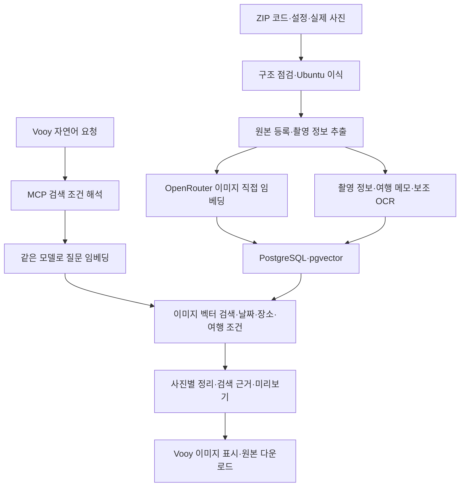

# Vooy 사진·추억 검색 및 ZIP 이식 개발 기획서 — OpenRouter 직접 이미지 임베딩 v2

> 구현 시 `executing-plans` 절차로 단계별 산출물과 검증 결과를 기록한다. 이 문서는 ZIP 수령 전의 기능·연동 설계다. 수령한 코드의 진입점과 의존성을 확인한 뒤 아래 책임에 실제 모듈을 대응시킨다.

**Goal:** Vooy에서 자연어로 사진·추억을 요청하면 실제 저장된 이미지의 내용, 촬영 정보, 사용자 기록을 검색해 이미지와 원본 다운로드를 제공한다.

**Architecture:** 기존 MCP·파일 저장소·PostgreSQL/pgvector를 사용한다. 전달받은 RAG를 Ubuntu용 워커로 이식하고 OpenRouter의 멀티모달 임베딩 API에 실제 이미지를 입력해 벡터를 생성한다. 같은 모델의 텍스트 질문 벡터로 이미지를 검색하고 날짜·장소·여행 조건을 결합해 Vooy에 사진을 전달한다.

**Tech Stack:** WSL2 Ubuntu-24.04, Python 3.12, Docker Desktop Linux 엔진, PostgreSQL 16/pgvector, 기존 HTTP MCP, OpenRouter Embeddings API, 우선 평가 모델 `google/gemini-embedding-2`.

기준일: 2026-11-07. 상태: 개발 기획 v2. 사용자 확정에 따라 API 경로는 OpenRouter, 주 검색 표현은 이미지 직접 임베딩으로 변경한다. 이 문서가 앞선 OpenAI 설명 기반 임베딩안을 대체한다. 공식 지원 문서는 확인했으며 ZIP 수령·실제 계정 호출·Vooy 사진 검색 검증은 구현 단계에서 수행한다.

## 1. 사용자 경험과 완료 범위

사용자는 다음처럼 말한다. 아래는 동작 설명을 위한 예시이며 실제 보유 사진에 관한 진술은 아니다.

| 요청 | 필요한 근거와 처리 | Vooy 응답 |
|---|---|---|
| “바닷가에서 빨간 우산 들고 찍은 사진 찾아줘” | 한국어 질문 벡터와 이미지 벡터 비교 | 관련 사진 3~5장과 확인 가능한 검색 근거 |
| “작년 제주도 여행 사진 보여줘” | 현재 날짜로 연도 해석, 촬영일·위치·여행 기록 필터 | 조건에 맞는 사진과 날짜·장소 |
| “그때 여행에서 카페 갔던 사진” | 앞선 대화에서 지정한 여행 ID + 카페 장면 | 같은 여행의 카페 사진 |
| “간판에 성산이라고 써 있던 사진” | OCR 문자열 검색 + 의미 검색 | 해당 글자가 보이는 사진 |
| “이 사진은 엄마랑 제주 여행 때 찍은 거야” | 선택된 사진에 사용자 설명·여행 관계 저장 | 기록 완료 후 해당 조건으로 재검색 |
| “두 번째 사진 원본 줘” | 직전 응답의 안정적인 사진 ID·버전 | 해당 원본의 다운로드 링크 |

이번 목표의 완료 범위는 ZIP 이미지·텍스트 수집, OpenRouter 기반 직접 임베딩, 텍스트→이미지 검색, 추억 기록 연결, MCP 응답 및 실제 Vooy 표시다. 기존 영상 저장·다운로드는 계속 사용한다. 이미지→유사 이미지 검색과 영상 프레임·시간 구간 검색은 같은 공간을 활용하는 후속 확장으로 둔다.

## 2. 확인된 현재 기반과 추가 개발

기존 프로젝트 루트는 `/home/pc/projects/vooy-mcp`다. 현재 코드·Compose·연동 문서를 확인했다.

| 영역 | 현재 구현 | 이번 추가 개발 |
|---|---|---|
| 원본 저장 | 이미지·영상 파일, 텍스트, 버전·체크섬 | ZIP 데이터 일괄 등록·이관 이력 |
| 관리 | 목록·다운로드·컬렉션·수정·삭제 | 촬영일·장소·사용자 추억 기록 |
| RAG 저장 | 모델 공간, 구간·벡터·파생물 저장 | 이미지 직접 임베딩과 텍스트 임베딩 생성 |
| 워커 계약 | 작업 획득·heartbeat·결과 검증·활성화 | ZIP 코드 어댑터와 OpenRouter 워커 |
| 질문 인코더 | 외부 HTTP 인코더 연결 인터페이스 | 같은 멀티모달 모델로 한국어 질문 처리 |
| 검색 | 같은 공간의 벡터 검색, 미디어 종류 필터 | 날짜·장소·여행 필터, 키워드 결합·중복 정리 |
| 결과 전달 | 구조화된 자료 정보와 다운로드 링크 | 미리보기·검색 근거·실제 Vooy 이미지 표시 |

`vooy_storage/query_encoder.py`는 `{"query": "...", "space_id": "..."}`를 외부 서비스에 보내는 어댑터다. `vooy_storage/mcp_tools.py`의 `search_assets`는 질문 벡터를 받아 검색하며, 현재는 날짜·장소 필터와 미리보기 반환을 제공하지 않는다.

## 3. OpenRouter 적용 방식과 모델

OpenRouter는 이미지 입력을 받는 멀티모달 임베딩 API를 제공한다. 입력의 `content` 배열에 `image_url`을 넣어 벡터를 요청할 수 있다. [공식 임베딩 안내](https://openrouter.ai/docs/api_reference/embeddings)

역할은 OpenRouter가 모델 호출·벡터 생성을 담당하고, 우리 서버가 원본 보관·색인·pgvector 검색·접근 링크를 담당하는 구성이다. OpenRouter의 RAG 구성 요소를 이용해 우리 저장소에 맞는 검색 파이프라인을 구현한다. [공식 RAG 구성 안내](https://openrouter.ai/docs/cookbook/evaluate-and-optimize/rag)

| 후보 | 확인한 공식 기능 | 이 프로젝트 적용 |
|---|---|---|
| `google/gemini-embedding-2` | 이미지·텍스트를 공통 벡터 공간에 표현, 128~3072차원 | 우선 평가 모델. 이미지 입력과 한국어 질의를 같은 모델로 처리 |
| `cohere/embed-5-pro` | 이미지·텍스트·혼합 입력, 256~2048차원 | 품질 비교 후보. 이미지 검색과 한국어 질의를 별도 평가 공간에서 비교 |

공식 모델 설명: [Gemini Embedding 2](https://openrouter.ai/google/gemini-embedding-2), [Cohere Embed 5 Pro](https://openrouter.ai/cohere/embed-5-pro). 우선 설정은 Gemini Embedding 2, 1536차원, 코사인 거리다. 768차원 비교와 모델별 비용·지연·검색 품질을 측정한 뒤 운영 구성을 확정한다. 현재 문서 확인과 실제 계정에서의 호출 성공은 별도 검증 항목이다.

이미지 한 장에 대해 **이미지만 입력한 벡터**를 필수 생성한다. 사용자 메모·여행 기록·OCR은 별도 텍스트 구간으로 임베딩하고 이미지 ID에 연결한다. 사진과 메모를 함께 넣는 결합 벡터는 추가 비교 실험으로 두어 원본 이미지 표현을 보존한다.

각 공간에 모델 ID, 제공 경로, 차원, 전처리 버전, 정규화, 질의·문서 입력 규칙, 모달리티를 기록한다. 단일 벡터 모델끼리도 공간이 다르면 순위 결합으로 비교하고 원시 거리값은 섞지 않는다. 동일 모델의 provider 변경은 고정 표본으로 호환성을 확인하고 실제 경로를 기록한다. 다른 모델로의 전환은 새 공간과 재색인으로 처리한다.

### 3.1 호출 계약

- 엔드포인트: `POST https://openrouter.ai/api/v1/embeddings`.
- 인증: `Authorization: Bearer <OpenRouter API key>`.
- 이미지 입력: `input` 배열의 항목 하나당 `content` 배열 하나, 그 안에 사진 한 장의 `image_url` 객체.
- 텍스트 질문: `input`에 해당 모델의 검색 질의 규칙을 적용한 텍스트.
- 공통: `model`, `dimensions`, `encoding_format="float"`.
- 결과: `data[].embedding`의 길이·유한 숫자·정규화 상태와 요청 대비 결과 개수를 검증하고 `index`로 원본과 대응한다. 이미지 한 장으로 먼저 검증한 뒤 일괄 호출을 확장한다.

위 필드는 [OpenRouter Embeddings API 명세](https://openrouter.ai/docs/api/api-reference/embeddings/submit-an-embedding-request)에 따른다. 실제 제공자가 요청 차원을 적용했는지는 반환 벡터 길이로 확인한다.

이미지 전송의 기본 계약은 전처리 JPEG/PNG의 짧은 HTTPS 읽기 URL이다. 워커 인증 헤더가 필요한 내부 원본 URL과 구분하여, 현재 작업·버전에 묶인 서명 입력 URL을 발급한다. 모델 호출 중 만료되지 않는 수명을 부여하고 삭제·버전 변경 시 접근을 해제한다. 인코딩한 이미지 바이트의 data URI 전달은 선택한 제공 경로의 실제 호출로 지원을 확인하면 사용할 수 있다.

Gemini Embedding 2의 텍스트 질의는 공식 권장 형식인 `task: search result | query: ...`를 첫 평가 구성으로 사용하고 문서는 `title: ... | text: ...`로 구분한다. 이미지 입력 자체에는 텍스트용 task 지시를 강제로 붙이지 않는다. 같은 `content`에 여러 사진을 넣어 한 벡터로 합치는 것과 사진별 벡터 생성은 구분해 시험한다. [Google 모델 입력 규칙](https://ai.google.dev/gemini-api/docs/embeddings)

Cohere 후보는 제공자 계약에서 `input_type=search_document`와 `search_query`를 구분한다. 모델별 입력 어댑터로 차이를 처리하며, Gemini에 Cohere용 설정을 그대로 전달하지 않는다.

### 3.2 이미지 설명·OCR의 위치

직접 이미지 임베딩이 기본 검색 경로다. OCR은 간판·문서의 정확한 문자 검색을, 이미지 설명은 결과 이해를 보완한다. ZIP에 포함된 추출기를 우선 활용하며 추가 모델 호출은 OpenRouter에서 선택한 비 OpenAI 모델을 사용한다. 설명 생성 성공 여부와 이미지 벡터 색인 성공 여부를 별도로 관리한다. 벡터만으로는 어떤 물체가 일치했는지 설명할 수 없으므로, 결과 근거는 저장 메타데이터·OCR·검증된 분석 결과에서 가져온다.

## 4. 전체 처리 흐름

업로드 확정 시 DB에 색인 예약 기록을 함께 남기고 워커가 처리한다. ZIP 일괄 등록과 이후 일반 업로드 모두 같은 예약 경로를 사용한다. 파일 등록 완료와 검색 준비 완료는 별도 상태로 표시한다.

## 5. ZIP 수령·이식 절차

1. ZIP 원본의 SHA-256, 파일 수·크기·구성을 기록하고 전용 수령 디렉터리에 보존한다. 압축 경로 이탈, 링크 대상, 풀린 크기를 검사해 코드·설정·모델·데이터를 구분한다.
2. README, 실행 진입점, 의존성 잠금 파일, Docker 구성, 데이터 스키마, 모델 호출·검색 코드를 읽고 입력부터 검색 결과까지의 흐름을 작성한다.
3. `.env`는 변수 이름·역할·참조 위치를 매핑한다. 키·토큰 값은 로컬 비밀 파일로 옮기며 분석 문서에는 변수 이름과 필요한 서비스만 기록한다.
4. 기존 Windows/macOS 경로를 Ubuntu 경로로 매핑한다. 가상환경과 의존성을 Linux에서 재구성하고 CPU/GPU·모델 런타임 요구를 실제 환경과 대조한다.
5. ZIP의 모델·전처리·질의 인코더를 읽고 기존 동작을 파악한다. 운영 임베딩 호출은 OpenRouter 어댑터로 교체한다. 포함 모델 파일의 역할·체크섬을 기록해 이식 검증에 활용한다.
6. 기존 코드의 분석·검색 기능을 표본으로 재현하고, 우리 저장소의 작업 API에 맞는 어댑터를 만든다. 이미지→벡터 호출과 텍스트→벡터 호출을 모두 확인한다. 원본 ID와 이식 후 자료 ID의 대응표를 남긴다.
7. ZIP에 기존 임베딩이 있으면 모델·차원·원본 해시가 확인되는 것만 별도 공간으로 등록한다. 나머지는 실제 원본에서 새로 생성한다.

산출물은 수령 manifest, 코드 구조 설명, 환경변수 매핑표, 실행 구성, 데이터 이관 보고서다. OpenRouter API 키는 워커·인코더 서비스의 비밀 파일로 전달한다. 제안 설정은 `VOOY_OPENROUTER_API_KEY_FILE`, `VOOY_EMBEDDING_MODEL`, `VOOY_EMBEDDING_DIMENSIONS`, `VOOY_EMBEDDING_PROVIDER`, `VOOY_EMBEDDING_PREPROCESS_REVISION`이며 일반 설정은 `.env.example`에 문서화한다. SDK 형식이 호환되더라도 호출 주소와 모델 선택은 OpenRouter 구성으로 명시한다.

## 6. 저장과 메타데이터

원본·파생 파일은 `/mnt/d/VOOY/media`, 구조화 정보와 텍스트는 PostgreSQL, 벡터는 pgvector에 보관한다. 기존 `asset_id`, `asset_version_id`, `collection_id`, `space_id`를 연결 키로 사용한다.

| 데이터 | 저장 내용·규칙 |
|---|---|
| 원본·출처 | 파일 해시, 원본 파일명, ZIP 상대경로, 원래 자료 ID, 버전 |
| 촬영 사실 | EXIF 원본 시각, UTC 변환 가능 여부, 시간대, GPS, 크기, 방향, 카메라 |
| 이미지 직접 벡터 | 이미지 한 장의 벡터, 입력 이미지 해시·변환 버전, 모델·차원·제공 경로 |
| 보조 이미지 분석 | OCR·설명·장면 정보, 불명확한 항목, 추출기·프롬프트 버전 |
| 사용자 기록 | 사진 설명, 여행명, 동행자 태그, 날짜·장소 수정과 기록 출처 |
| 여행 묶음 | 기존 컬렉션에 여행 기간·장소·설명을 연결 |
| 검색 표현 | 필수 이미지 구간과 별도 사용자 메모·OCR·텍스트 구간 |
| 미리보기 | 방향 보정된 JPEG/WebP, 원본·분석 버전 연결 |

추가 테이블의 책임은 다음과 같다. 이름은 새 마이그레이션 기준으로 적용한다.

- `asset_facts`: 원본 버전별 촬영 시각·GPS·크기와 필드별 출처. 원본 EXIF와 검색용 정규화 값을 함께 보관한다.
- `asset_annotations`: 사용자 설명·수정 이력, 자료·컬렉션 참조, 증가하는 revision.
- `collection_details`: 여행 기간·장소·표시 이름 등 기존 컬렉션의 추가 속성.
- `asset_analysis_runs`: 원본 버전별 이미지 전처리·직접 임베딩·보조 추출의 단계 상태, 사용량, 재사용 키.
- 기존 `rag_jobs`·`rag_result_sets`에 입력 설명 revision·검색 표현 revision을 연결한다. 기존 `rag_segments`, `rag_embeddings`, `rag_artifacts`를 재사용한다.

EXIF·사용자 입력·AI 추정을 구분한다. GPS 없는 사진의 장소 후보는 추정으로 표시하고, 파일 수정 시각은 촬영일과 별도로 저장한다. 인물 이름·가족 관계는 사용자가 제공한 태그·기록에 연결한다. 시간대 없는 촬영일은 원래 현지 날짜와 시간대 미상 상태를 유지한다.

GPS만 있는 자료는 장소명 해석 단계를 둔다. 1차에는 전달 데이터의 장소표·사용자 여행 기록을 우선 사용하고, 좌표만으로 장소명이 필요한 경우 이식 시 지오코딩 제공자를 구성해 결과를 캐시한다. 좌표와 장소명 출처를 함께 남긴다.

HEIC 등은 원본을 보존하고 임베딩 입력용 JPEG/PNG로 변환한다. EXIF 방향·색상 공간·크기 정책을 버전으로 고정하고, 원본 해시와 실제 API 입력 이미지 해시를 함께 저장한다. 입력 사진은 전체 구도를 유지한다. 세부 영역 임베딩은 원본 이미지의 보완 구간으로 평가한다. 미리보기에서는 위치 EXIF를 제거하고 필요한 촬영 정보는 응답 필드로 전달한다.

## 7. 직접 임베딩 워커

권장 실행 구성은 기존 `postgres`, `vooy-mcp`에 `rag-worker`, `rag-query`를 추가하는 것이다. 두 서비스는 동일한 OpenRouter 모델·공간 설정을 공유하며 질문 인코더는 내부 네트워크로 연결한다. ZIP의 의존성이 무거우면 별도 워커 이미지에 설치해 MCP의 현재 Alpine 런타임과 분리한다.

워커는 작업을 획득한 뒤 원본 접근 → 메타데이터 추출·이미지 전처리 → OpenRouter 이미지 임베딩 → 벡터 검증·저장 → 검색 활성화 순서로 실행한다. 기존 lease·heartbeat·결과 제출 계약을 사용한다. 보조 OCR·설명·메모 임베딩은 별도 표현으로 합류시킨다.

검색 표현은 다음처럼 분리한다.

- 이미지: 전체 이미지 입력에서 생성한 필수 벡터. `kind=image`, 전체 영역 locator로 원본 버전을 참조한다.
- 문자: 보조 OCR 원문·정규화 문자열. 정확한 문자 검색과 필요 시 텍스트 벡터에 사용한다.
- 추억: 사용자 설명, 연결된 여행·컬렉션 기록을 같은 모델의 텍스트 구간으로 표현한다.
- 텍스트 자료: 본문을 구간화하고 원문 위치와 관련 사진 ID를 연결한다.

날짜·GPS 등 정확 조건은 구조화 필드로 조회한다. 장소 표시명과 사용자 설명은 의미 검색에도 사용한다. 사진당 여러 구간이 검색되면 자료 ID로 묶어 반환한다.

이미지 벡터 재사용 키는 원본·입력 이미지 해시, 전처리 버전, 모델·제공 경로, 차원, 정규화 규칙이다. 텍스트 벡터 키에는 내용 해시와 질의·문서 규칙, 메모 revision을 추가한다. 여행 설명을 고치면 해당 텍스트 표현을 다시 생성하고 같은 사진의 직접 이미지 벡터는 재사용한다. 한 결과 묶음으로 재활성화할 때도 기존 벡터를 서버에서 검증해 재사용하도록 결과 계약을 확장한다.

작업 상태는 대기·전처리 중·임베딩 중·검색 가능·실패로 조회하며 보조 추출 상태를 별도 표시한다. 429·529·일시적 서버 오류·연결 실패는 대기시간을 늘려 재시도하고, 인증·잔액·모델 접근·입력 오류는 각각 기록한다. 완료된 단계와 벡터를 체크포인트로 저장하고 재시작 시 이어서 처리한다. 결과 수·index 누락 또는 차원 불일치는 활성화 전에 거부한다. 서버가 결과를 받았는지 불명확한 타임아웃은 별도 기록해 중복 호출량을 집계한다.

동시 실행 수·이미지 입력 크기·보조 추출 여부를 설정한다. 실제 API 사용량과 제공된 비용 필드를 기록해 표본 비용과 전체 예상 비용을 계산한다. 사진당 독립 벡터가 생성되는지 먼저 확인한 뒤, 30~50장으로 직접 검색 품질·비용을 측정하고 전체 데이터를 색인한다.

## 8. 자연어 검색과 대화 문맥

1. Vooy가 사용자 질문과 대화에서 이미 확정한 여행·사진 참조를 MCP 인수로 전달한다.
2. 서버가 질문을 장면·문자·기간·장소·여행 조건으로 정규화한다. 상대 날짜는 요청의 기준 시각·시간대를 사용한다.
3. 같은 모델로 생성한 질문 벡터를 이미지 벡터와 비교하고, 날짜·장소·여행 필터를 검색 대상에 적용한다. 하드 필터를 적용하기 전 상위 몇 개만 잘라 관련 사진을 놓치는 방식은 사용하지 않는다.
4. 사용자 메모·여행 기록의 텍스트 벡터와 한국어 OCR·고유명사 문자열 검색을 보완 경로로 사용한다. 이미지·텍스트·문자 경로의 결과를 순위 기반으로 결합한다.
5. 구간을 사진별로 묶고 완전 중복·유사 사진은 대표 이미지로 정리한다. 원본 목록은 별도로 조회할 수 있게 한다.
6. 세부 관계를 구분해야 하는 질의는 상위 후보만 다시 평가한다. OpenRouter의 이미지 입력 지원 재정렬 모델 또는 비 OpenAI 이미지 이해 모델을 실제 평가 후 선택한다. 기본 검색과 재정렬의 품질·지연을 별도로 측정한다.

“그때”, “그 여행”을 해석할 문맥은 Vooy가 도구 호출에 전달해야 한다. MCP가 모든 Vooy 대화를 자동으로 받는다는 전제는 두지 않는다. 필요한 여행 참조가 없으면 `needs_clarification`과 선택 가능한 여행 후보를 반환하고 Vooy가 한 번 확인하도록 한다. 여행이 이미 지정됐다면 추가 확인 없이 검색한다.

`search_assets` 확장 인수: `query`, `kinds`, `limit`, `filters`, `context`, 선택적 `space_id`.

- `filters`: `captured_from`, `captured_to`, `place_ids`, `collection_ids`, `tags`, `date_basis`.
- `context`: `reference_time`, `timezone`, `collection_id`, `reference_asset_ids`, 관련 대화 요약.
- 응답: `status`, `resolved_query`, `applied_filters`, `results`, 필요한 경우 `clarification`.
- 결과 항목: `asset_id`, `version_id`, `title`, 선택적 `caption`, `captured_at`, `place`, `matched_evidence`, `retrieval_channels`, `preview`, `download`, `expires_at`. 캡션이 없더라도 사진과 촬영 정보를 반환한다.

근거가 약하거나 조건에 맞는 자료가 없으면 `no_match`를 반환한다. 날짜·장소 조건을 완화한 결과가 필요하면 별도 결과임을 표시한다. 벡터 유사도를 확률이나 “정확도 95%”로 표현하지 않는다.

## 9. Vooy 이미지 전달

기존 검색의 링크 반환에 다음 기능을 더한다.

- `search_assets`: 기본 5개 결과와 검색 근거·미리보기 참조를 반환한다.
- `get_image_preview(asset_id, version_id)`: 이미지 내용과 원본 링크를 요청할 수 있게 한다.
- `get_download_link`: 기존 원본 다운로드와 만료 후 링크 재발급에 사용한다.
- `annotate_asset`: 사용자 추억·촬영 정보 수정 및 재색인 예약.
- `update_collection_details`: 여행 기간·장소·설명 저장.

Vooy 호환 시험은 작은 실제 사진 한 장으로 조기에 진행한다. SDK의 이미지 응답(`ImageContent`)과 HTTPS 미리보기 링크를 각각 시험해 실제 대화 화면에 보이는 경로를 선택한다. 링크 문자열을 받았다는 사실과 이미지가 표시됐다는 사실을 별도 검증한다.

미리보기는 작은 크기로 제공하고 한 응답의 사진 수·총 바이트를 제한한다. 원본은 기존 서명 다운로드 URL로 제공한다. 기본 유효시간은 기존 15분을 유지하고 만료 시 자료 ID로 재발급한다. 미리보기에는 올바른 이미지 MIME과 표시용 응답 헤더를 적용한다.

서버가 반환한 실제 URL과 자료 ID를 Vooy가 그대로 사용하도록 도구 설명과 응답 예시를 작성한다. “두 번째 사진” 같은 후속 요청은 직전 응답의 ID를 참조한다. Vooy 렌더링 확인 결과는 통합 테스트 기록에 남긴다.

## 10. 파일별 구현 책임

아래 경로는 기존 프로젝트 루트를 기준으로 한 제안이다. ZIP 구현에서 같은 책임을 가진 모듈이 확인되면 해당 코드를 이식해 사용한다.

| 파일·경로 | 작업 |
|---|---|
| `/home/pc/projects/vooy-mcp/scripts/import_zip_dataset.py` | 수령 manifest·데이터 등록·재개·원본 ID 대응 |
| `/home/pc/projects/vooy-mcp/rag_worker/metadata.py` | EXIF·방향·파일 정보 정규화 |
| `/home/pc/projects/vooy-mcp/rag_worker/image_preprocess.py` | 방향·색상·크기·형식 변환 및 입력 해시 |
| `/home/pc/projects/vooy-mcp/rag_worker/openrouter_embeddings.py` | 이미지·텍스트 API 호출, 모델별 입력 규칙·벡터·사용량 검증 |
| `/home/pc/projects/vooy-mcp/rag_worker/enrichment.py` | ZIP 추출기 또는 OpenRouter 보조 OCR·설명 |
| `/home/pc/projects/vooy-mcp/rag_worker/pipeline.py` | 작업 API·단계 상태·재시도·결과 제출 |
| `/home/pc/projects/vooy-mcp/rag_worker/query_server.py` | 기존 질문 인코더 계약 구현 |
| `/home/pc/projects/vooy-mcp/vooy_storage/memory_metadata.py` | 촬영 사실·추억 기록·여행 속성 |
| `/home/pc/projects/vooy-mcp/vooy_storage/search.py` | 필터·의미·문자 검색 결합과 자료별 정리 |
| `/home/pc/projects/vooy-mcp/vooy_storage/previews.py` | 미리보기·MCP 이미지 반환 |
| `/home/pc/projects/vooy-mcp/vooy_storage/inference_grants.py` | 작업·버전에 묶인 API 입력 이미지 HTTPS 읽기 권한 |
| `/home/pc/projects/vooy-mcp/vooy_storage/rag.py` | 입력 revision·필터·활성 결과 연결 |
| `/home/pc/projects/vooy-mcp/vooy_storage/mcp_tools.py` | 검색 확장·사진 확인·추억 기록 도구 |
| `/home/pc/projects/vooy-mcp/compose.yaml` | 워커·질문 인코더·비밀 파일·실행 설정 |
| `/home/pc/projects/vooy-mcp/docs/rag-contract-v1.md` | 직접 이미지 구간·입력 revision·벡터 재사용·촬영 정보 제출 계약 |
| `/home/pc/projects/vooy-mcp/scripts/evaluate_image_search.py` | 정답셋 기반 검색·지연·비용 평가 |

## 11. 개발 단계와 검증 산출물

| 순서 | 작업 | 완료 증거 |
|---|---|---|
| 1 | ZIP 분석·환경 이식·OpenRouter 연결 | 구성·환경 매핑표, 이미지와 텍스트의 실제 벡터 응답 |
| 2 | 실제 사진 1장으로 Vooy 반환 방식 확인 | 이미지 표시·원본 다운로드 확인 기록 |
| 3 | 원본 등록·촬영 정보·추억 기록 | 해시·원본 ID 대조, EXIF·수정 이력 테스트 |
| 4 | OpenRouter 직접 이미지·텍스트 임베딩 | 사진별 벡터와 API 입력 해시 대조, 공간·차원·사용량 확인 |
| 5 | 텍스트→이미지 검색·필터·대화 참조 | 실제 사진 정답셋 결과, 보조 정보 없는 직접 검색 및 결합 검색 비교 |
| 6 | 전체 MCP·Vooy 연결 | 자연어 요청 → 사진 표시 → 원본 다운로드 |
| 7 | 전체 색인·재시작·복구·운영 문서 | 처리 집계, 재시작 후 검색, 백업·복구 결과 |

체크리스트:

- [ ] ZIP 코드·모델·실제 데이터의 입력부터 출력까지 연결 관계를 설명할 수 있다.
- [ ] 원본 보관·이미지 임베딩·보조 추출·검색 가능 상태를 각각 조회할 수 있다.
- [ ] OpenRouter에 실제 이미지 바이트를 포함한 입력 또는 해당 이미지 URL을 보내 직접 벡터를 생성한다.
- [ ] 캡션·OCR·파일명·메모를 입력에서 제외한 사진 벡터와 한국어 질문 벡터만으로 관련 사진을 검색한다.
- [ ] 실제 이미지와 텍스트를 같은 멀티모달 모델·차원·호환 입력 규칙으로 색인한다.
- [ ] 이미지 N장의 독립 입력과 응답 벡터 N개가 정확히 대응한다.
- [ ] 날짜·장소·여행 필터가 실제 자료 근거와 일치한다.
- [ ] 추억 설명 수정·사진 교체·삭제가 후속 검색에 반영된다.
- [ ] MCP를 통해 질문을 호출하고 Vooy 화면에서 관련 사진을 볼 수 있다.
- [ ] 표시한 사진의 원본 다운로드 해시가 등록 원본과 같다.
- [ ] 재시작·실패 재시도·백업 복구 후에도 동일 자료를 조회할 수 있다.

## 12. 실제 데이터 평가

전달 사진 중 대표 표본 100~300장과 한국어 질문 40~60개로 평가셋을 만든다. 데이터가 더 적으면 전체를 사용한다. 장면, OCR, 날짜·장소, 추억·여행, 문맥 후속 질문, 정답 없음·모호한 질문을 포함한다.

정답은 원본 사진과 EXIF·사용자 기록을 직접 대조해 정한다. 개인적인 사건의 의미는 사용자가 제공한 기록을 기준으로 한다. 개발용 질문과 최종 평가 질문은 분리한다. 장면·물체 질의는 캡션·OCR·파일명 없이 이미지 벡터만 사용한 검색을 별도로 평가하고, 추억·날짜·장소 질의는 메타데이터를 결합해 평가한다.

| 평가 | 초기 합격 목표·측정 방식 |
|---|---|
| 찾을 수 있는 질문 | 최종 평가 질의의 Hit@5 90% 이상: 상위 5장 안에 적합 사진 1장 이상 |
| 직접 이미지 검색 | 장면 질의별 이미지 전용 Hit@5와 결합 검색 Hit@5를 나란히 기록 |
| 날짜·장소·여행 조건 | 명시한 하드 필터 위반 0건, 누락 메타데이터 동작 별도 평가 |
| 여행 전체 조회 | 정답 사진 집합 대비 Recall@20 기록, 결과가 많으면 페이지 조회 검증 |
| 없는 자료 | 정답 없음 평가셋의 90% 이상에서 적합 사진 없음으로 응답 |
| 원본·화면 | 선정 테스트 사진의 이미지 표시·원본 해시 일치 100% |
| 수정·삭제 | 수정 revision 반영, 삭제 자료의 검색·신규 접근 제외 |
| 응답 시간 | 재색인 없는 기본 검색의 MCP 응답 p95 5초 이내 목표; Vooy 표시 지연은 별도 측정 |
| 비용 | 이미지당 직접 임베딩, 1천 장 색인, 질문 임베딩, 선택적 OCR·재정렬 비용을 각각 기록 |

위 수치는 개발 목표다. 데이터 수·질의별 실제 결과와 실패 사례를 함께 보고한다. 색인 규모가 커지면 정확 검색을 기준선으로 공간별 근사 인덱스를 비교하고, 차원·필터별 재현율과 지연을 측정해 적용한다.

회귀 검증에는 EXIF 없는 사진, 한국어 파일명, HEIC·회전 이미지, 비슷한 연속 사진, 긴 텍스트, 같은 ZIP 재등록, 중간 재시작, 이미지 입력 URL 만료, 여러 이미지의 의도치 않은 단일 벡터 합산, 응답 순서·개수 오류, 402·429·529, 잘못된 차원, 색인 중 원본 교체·삭제를 포함한다. 메모만 수정했을 때 이미지 임베딩 API의 추가 호출이 발생하는지도 확인한다.

## 13. 운영과 인수인계

현재 Ubuntu 개발 경로와 Docker 엔진을 그대로 사용한다. 워커·질문 인코더 상태, 모델·공간, 미처리 작업 수, 실패 유형, 최근 처리 시간, OpenRouter 사용량을 조회할 수 있게 한다. 모델·차원·전처리 변경은 새 결과 버전으로 처리하고 완성된 결과만 활성화한다.

백업·복구에 새 메타데이터·추억 기록·분석 결과·파생물의 참조 검증을 추가한다. 기존 서비스 정지형 백업 절차에 새 워커도 포함해 진행 중 작업이 복구 후 정상 재개되는지 확인한다.

외부 연결은 현재 연결된 테스트 주소에서 검증한다. 고정 HTTPS 주소 연결은 상시 운영 항목으로 관리한다. URL은 발급 시 현재 공개 주소로 만들고, 장기 식별에는 자료 ID를 사용한다.

최종 인수인계는 실행 방법, ZIP 이식 결과, 설정 변수 목록, 데이터 처리 집계, 실제 사진 검색 평가, Vooy 확인 기록, 비용 측정, 백업·복구 절차로 구성한다.

ZIP에 포함되면 이식에 바로 활용할 자료: 소스·실행 안내·의존성 잠금 파일, 환경 설정, 모델 정보 또는 파일, 원본 사진·텍스트, 기존 메타데이터와 자료 ID 대응, 기대 검색 예시. 파일 구성을 확인해 부족한 정보만 후속 확인한다.
