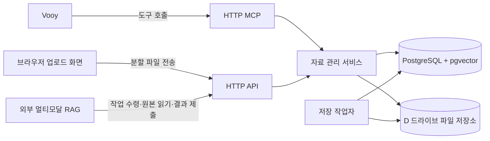

# Vooy 미디어 저장소·임베딩 연동 Implementation Plan

> **For agentic workers:** REQUIRED SUB-SKILL: Use `executing-plans` to implement this plan task-by-task. Steps use checkbox (`- [ ]`) syntax for tracking.

**Goal:** Vooy에서 이미지·영상·텍스트를 보관하고 조회하며, 별도로 개발 중인 멀티모달 RAG가 원본을 읽고 구간·임베딩 결과를 저장할 수 있는 기반을 만든다.

**Architecture:** 기존 HTTP MCP 서버에 자료 관리 서비스와 업로드 API를 연결한다. 원본·파생 파일은 D 드라이브, 메타데이터·텍스트·작업·임베딩은 전용 PostgreSQL/pgvector에 저장한다. RAG 엔진은 작업 API로 연결하고 저장 완료와 검색 준비 완료를 구분한다.

**Tech Stack:** WSL2 Ubuntu-24.04, 기존 Python 3.12/MCP SDK 2.x/Starlette/Uvicorn, PostgreSQL 16 + pgvector, SQLAlchemy 2.x + psycopg 3 + Alembic, Docker Desktop Linux 엔진, Windows Cloudflared, HTML/CSS/JavaScript 업로드 화면.

---

작성일: 2026-11-07. 상태: 개발 기획 v1. 프로젝트: `/home/pc/projects/vooy-mcp`.

## 1. 목표와 범위

### 사용자에게 제공할 결과

1. Vooy에서 “이 내용을 저장해 줘”라고 하면 텍스트 자료가 생성된다.
2. “영상 올릴 수 있게 해 줘”라고 하면 업로드 페이지를 받는다. 파일을 올린 뒤 Vooy에서 자료 ID로 조회한다.
3. 제목·종류·태그·컬렉션으로 자료를 찾고, 원본을 내려받거나 정보를 수정한다.
4. RAG 연결 후에는 “바닷가에서 촬영한 장면 찾아 줘” 같은 요청으로 이미지나 영상의 해당 구간을 찾는다.
5. RAG 결과에는 원본 버전과 문서 페이지·영상 시각이 연결되어 출처를 다시 열 수 있다.

### 개발 범위의 분담

| 구성 | 이 프로젝트의 역할 | 외부 RAG의 역할 |
|---|---|---|
| 자료 수집 | 파일·텍스트 저장, 버전·출처·접근권한 관리 | 원본 읽기 |
| 전처리 | 파생 파일과 추출 구간의 수신·보관 | OCR, 자막·음성 인식, 영상 프레임·문서 구간 추출 |
| 임베딩 | 모델 공간 등록, 벡터 수신·검증·보관 | 모델 실행, 임베딩 생성 |
| 검색 | 필터, 벡터 후보 조회, 출처·다운로드 연결 | 질문 임베딩, 모델별 다중 벡터 점수·재정렬 |
| 실행 관리 | 작업 발급·임대·재시도·결과 활성화 | 작업 수령·진행 보고·결과 제출 |

첫 배포는 **저장소로 독립 사용 가능한 상태**를 목표로 한다. RAG 모델이 연결되기 전에도 업로드·목록·다운로드가 완결된다. 모델별 의미 검색은 실제 RAG 연동 단계의 산출물이다.

## 2. 기술 결정과 현재 상태

| 항목 | 개발 기준 |
|---|---|
| 기존 기능 | `server.py`의 `/mcp`, `/healthz`, `ping`, Bearer 인증, Vooy 연결 확인 |
| 원본 저장 | 호스트 `/mnt/d/VOOY/media` → 컨테이너 `/data/media` |
| DB | 프로젝트 전용 PostgreSQL 16/pgvector 컨테이너, DB·계정·named volume |
| DB 데이터 위치 | Docker named volume. 애플리케이션은 내부 Docker 네트워크로 접근 |
| 저장 형태 | DB에는 `storage_backend`, `object_key`; 파일명은 표시용 정보 |
| Python 구조 | 기존 `server.py` 실행 진입점을 유지하고 기능을 `vooy_storage/`로 분리 |
| 브라우저 화면 | 업로드 화면 1개부터 시작. 관리 기능은 MCP로 제공 |
| 작업 큐 | PostgreSQL의 `jobs`와 별도 `storage-worker` 프로세스 |
| 임베딩 저장 | pgvector `vector` 컬럼 + 등록한 공간의 차원 검증; 실제 모델별 인덱스 마이그레이션 |
| 운영 주소 | 기존 Windows 터널에 고정 HTTPS 경로 연결. 공개 기본 URL은 설정으로 관리 |
| 사용자 범위 | 대표 1인 소유 범위로 시작하고 모든 자료·작업에 `scope_id` 부여 |

PostgreSQL을 자료 목록과 임베딩의 공통 기준으로 사용한다. 원본 파일은 파일 저장소가 담당하므로 대용량 영상 증가와 DB 백업을 각각 관리할 수 있다. pgvector는 차원 미지정 `vector` 저장과 동일 차원 대상의 인덱스를 지원하므로, 모델이 정해지기 전에도 수신·보관 계약을 마련할 수 있다. [pgvector 공식 문서](https://github.com/pgvector/pgvector#can-i-store-vectors-with-different-dimensions-in-the-same-column)

현재 서버의 MCP 요청 한도는 16 KiB다. 텍스트 도구를 추가할 때 MCP JSON 한도를 256 KiB로 조정하고, 실제 텍스트는 UTF-8 64 KiB로 제한한다. 파일 업로드와 벡터 배치는 별도 HTTP 경로와 한도를 사용한다.

### 초기 설정값 제안

아래 값은 v1의 조정 가능한 개발 기본값이다. 용량·성능 검증 결과는 운영 설정에 반영한다.

| 설정 | 초기값 | 적용 대상 |
|---|---|---|
| 직접 텍스트 | UTF-8 64 KiB | `save_text` 본문 |
| 파일당 크기 | 10 GiB | 이미지·영상·오디오·문서·텍스트 파일 |
| 파일 전송 조각 | 8 MiB, 마지막 조각은 잔여 크기 | 순차 분할 업로드 |
| 업로드 세션 | 생성 후 24시간 | 업로드·재개·확정 요청 |
| 업로드 링크 교환 | 15분, 최초 1회 사용 | 브라우저에 세션 권한 부여 |
| 다운로드 링크 | 15분 | 특정 자료 버전의 읽기 |
| 일반 JSON API | 256 KiB | 메타데이터·세션 생성 |
| RAG 결과 배치 | 요청 본문 8 MiB, 벡터 최대 256개 | 먼저 도달한 한도 적용 |
| 작업 임대 / heartbeat | 5분 / 60초 | 내부 작업자·외부 RAG 작업자 |
| 재시도 | 최초 실행 + 재시도 최대 3회, 30초→2분→10분 | 재시도 가능한 실패 |
| 목록 크기 | 기본 20개, 최대 100개 | 커서 페이지네이션 |
| 업로드 동시 처리 | 세션당 전송 1개, 파일 확정 작업자 1개 | 초기 메모리·디스크 사용 제어 |

저장 가능한 형식의 초기 목록은 JPEG/PNG/WebP/GIF/HEIC, MP4/MOV/WebM, MP3/WAV/M4A, PDF/TXT/Markdown/JSON이다. 저장 지원과 브라우저 미리보기 지원을 구분한다. DOCX 등 추가 형식은 업로드 검증 목록과 외부 RAG 지원 형식에 함께 반영한다.

## 3. 전체 구조



Compose 서비스는 `vooy-mcp`, `storage-worker`, `postgres`, 일회성 `migrate`로 구성한다. API와 작업자는 같은 애플리케이션 이미지를 사용한다. `migrate` 완료 후 API와 작업자를 시작한다. 외부에는 기존 애플리케이션 포트 3185만 연결한다.

파일 읽기·쓰기와 체크섬 계산은 스트리밍 및 작업자에서 처리한다. 영상 전체를 메모리에 올리거나 MCP 도구 호출이 끝날 때까지 파일 검증을 기다리는 구조 대신, 확정 작업 ID를 반환하고 상태를 조회한다.

## 4. 자료·상태 모델

### 핵심 테이블

공통 규칙: ID는 UUID, 시간은 UTC `timestamptz`, 크기는 `bigint`, 부가 정보는 `jsonb`다. 자료·자식 자료의 연결에는 `(scope_id, id)` 복합 키를 사용해 소유 범위 일치를 검증한다.

| 테이블 | 주요 필드·역할 | 주요 제약 |
|---|---|---|
| `scopes` | `id`, `name`, `created_at` | 최초 소유 범위 1개 |
| `assets` | `id`, `scope_id`, `kind`, `title`, `source`, `metadata_revision`, `current_version_id`, `deleted_at` | 현재 버전은 동일 자료·범위에 속함 |
| `asset_versions` | `id`, `asset_id`, `version_no`, `storage_backend`, `object_key`, `text_body`, `mime_type`, `size_bytes`, `sha256`, `media_info` | 자료별 버전 번호 유일; 텍스트 본문/파일 위치 중 하나; 원본 불변 |
| `collections` | `id`, `scope_id`, `name`, `description` | 범위 내 이름 유일 |
| `asset_collections` | `scope_id`, `asset_id`, `collection_id` | 연결 중복 방지 |
| `asset_tags` | `scope_id`, `asset_id`, `tag` | 동일 태그 중복 방지 |
| `upload_sessions` | `id`, `scope_id`, `purpose`, `asset_id`, `expected_current_version_id`, `expected_size`, `expected_sha256`, `state`, `expires_at`, `version_id`, `result_set_id`, `artifact_id`, `lease_epoch` | 원본/파생물 목적별 필드 검증; 성공한 확정은 같은 대상 ID 반환 |
| `upload_parts` | `upload_id`, `part_no`, `size_bytes`, `sha256`, `object_key` | `(upload_id, part_no)` 유일 |
| `access_grants` | `id`, `scope_id`, `token_hash`, `purpose`, `resource_id`, `expires_at`, `redeemed_at`, `revoked_at` | 업로드·원본 읽기 등 목적/자료에 권한 고정 |
| `idempotency_records` | `scope_id`, `operation`, `request_key`, `payload_hash`, `response` | 같은 키·같은 내용은 같은 결과; 내용 변경 시 409 |
| `jobs` | `id`, `scope_id`, `kind`, `target_id`, `source_version_id`, `pipeline_revision`, `state`, `attempt`, `lease_epoch`, `lease_until`, `run_after`, `error_code` | 수령·연장·제출에 임대 세대 검증 |
| `embedding_spaces` | `id`, `model_id`, `model_revision`, `dimensions`, `metric`, `normalization`, `preprocessing_revision`, `modalities`, `representation` | 등록 후 불변; 설정 변경은 새 공간 |
| `result_sets` | `id`, `scope_id`, `asset_version_id`, `job_id`, `lease_epoch`, `space_id`, `state`, `manifest`, `activated_at` | 자료 버전·공간별 활성 결과 묶음 최대 1개 |
| `segments` | `id`, `scope_id`, `result_set_id`, `external_id`, `kind`, `text`, `locator` | 묶음 내 외부 ID 유일 |
| `artifacts` | `id`, `scope_id`, `result_set_id`, `kind`, `object_key`, `mime_type`, `sha256`, `extractor_revision` | 원본 버전과 결과 묶음으로 출처 추적 |
| `embeddings` | `scope_id`, `result_set_id`, `segment_id`, `space_id`, `vector_ordinal`, `embedding` | `(result_set_id, segment_id, vector_ordinal)` 유일 |
| `result_batches` | `result_set_id`, `batch_id`, `payload_hash`, `segment_count`, `vector_count` | 같은 배치의 중복 전송을 동일 결과로 처리 |
| `backup_runs` | `id`, `state`, `manifest_key`, `started_at`, `completed_at` | 완료 전 manifest 참조 파일을 정리에서 보존 |

`embedding_spaces`는 모델 설정 카탈로그다. 이를 사용하는 자료·벡터의 접근 범위는 `result_sets`와 `embeddings`의 `scope_id`로 제한한다. 자료·작업 식별자를 알고 있어도 인증 범위에 속하지 않으면 조회 결과는 404다. `backup_runs`는 운영 단계에서 추가한다.

`jobs.kind`는 `upload_finalize`, `asset_cleanup`, `url_import`, `rag_ingest`, `reconcile`을 사용한다. 원본을 아직 만들지 않은 업로드 확정 작업의 `source_version_id`는 비어 있고, `rag_ingest`에서는 필수다. 새 명시적 재처리는 같은 자료 버전·공간의 이전 미완료 작업을 `superseded`로 바꿔 최신 작업만 활성화할 수 있게 한다.

### 버전과 상태

- **자료:** 활성 → 삭제됨. 삭제 시 목록·다운로드·검색에서 즉시 제외한다. 물리 정리는 별도 작업으로 추적한다.
- **업로드:** `created → uploading → finalizing → completed`; 실패는 `failed`, 만료는 `expired`다. 파일 선택 전에는 자료가 생성되지 않는다.
- **작업:** `queued → running → succeeded`; 재시도 가능 실패는 `queued`로 돌아가고, 소진·입력 오류는 `failed`, 삭제는 `canceled`, 더 최신 입력으로 교체되면 `superseded`다.
- **결과 묶음:** `staging → active → superseded`; 실패·임대 교체로 버려진 묶음은 `discarded`다.
- **화면 상태:** `저장 완료`, `분석 대기`, `분석 중`, `검색 준비 완료`, `분석 실패`를 별도로 표시한다. 분석 실패 자료도 원본을 내려받을 수 있다.

같은 원본을 새 모델로 재처리할 때 기존 활성 결과를 유지하고 새 묶음이 준비되면 교체한다. 원본 자체가 변경되면 기본 검색 대상은 새 `current_version_id`다. 과거 버전 검색은 명시적으로 요청할 때만 제공한다.

원본 교체 요청은 `expected_current_version_id`, 메타데이터 수정은 `expected_metadata_revision`을 받는다. 동시에 수정되어 기준 버전이 달라지면 409로 현재 버전을 반환한다.

### 구간 위치 표현

| 종류 | `locator` 예시 | 기준 |
|---|---|---|
| 텍스트 | `{"char_start":0,"char_end":120}` | 저장된 원문 Unicode 코드포인트, 끝 제외 |
| 문서 | `{"page":3,"bbox":[0.1,0.2,0.7,0.8]}` | 페이지 1부터; 좌표는 원본 페이지 기준 0~1 |
| 이미지 | `{"bbox":[0.0,0.0,1.0,1.0]}` | 좌상단 원점, `[x1,y1,x2,y2]` |
| 영상·음성 | `{"start_ms":12400,"end_ms":18900}` | 원본의 밀리초, 끝 제외 |

외부 RAG에서 정규화한 텍스트를 기준으로 오프셋을 만들었다면 그 텍스트를 artifact로 보관하고 `locator.artifact_id`를 지정한다. 영상 프레임은 시각과 해당 프레임 artifact를 함께 연결한다.

## 5. 파일 저장과 업로드

### 디렉터리 정책

```text
/mnt/d/VOOY/media/
  staging/{scope_id}/{upload_id}/parts/{part_no}
  staging/{scope_id}/{upload_id}/assembled
  originals/{scope_id}/{asset_id}/{version_id}/source
  derived/{scope_id}/{version_id}/{result_set_id}/{artifact_id}
```

UUID와 서버가 만든 객체 키만 경로에 사용한다. 원본 이름은 DB에서 보존한다. v1의 중복 검출은 `(scope_id, sha256, size_bytes)`로 수행하고, 자료별 파일·제목·출처는 독립적으로 보관한다. 물리적 공유 파일과 참조 횟수 관리는 실제 절감 필요량을 측정한 후 도입한다.

### 업로드 순서

1. `create_upload`로 제목·예상 종류·선택적 원본 교체 대상을 지정한다. 업로드 ID와 페이지 링크를 받는다.
2. 브라우저가 링크 fragment의 일회성 권한을 교환한다. 서버는 해당 세션에만 유효한 `HttpOnly`, `Secure`, `SameSite=Strict` 쿠키를 발급한다. 브라우저는 fragment를 지운다.
3. 파일 선택 후 이름·크기·선언 MIME·선택적 전체 SHA-256을 등록한다. 세션에 파일 정보를 확정한 뒤 첫 조각을 전송한다.
4. 조각을 순서대로 PUT한다. 서버는 실제 바이트 수와 SHA-256을 계산해 임시 파일에 쓴 뒤 조각 파일·DB 레코드를 확정한다.
5. 같은 조각 번호·같은 해시 재전송은 성공으로 응답한다. 내용이 달라지면 409다. 다음 순번보다 앞선 새 조각도 409와 `next_part_no`를 반환한다.
6. 새로고침이나 연결 중단 후 상태 API로 이미 저장된 조각을 확인한다. 같은 파일을 다시 선택하면 크기·선택한 파일의 조각 해시를 대조하고 이어 보낸다.
7. 완료 요청은 `upload_finalize` 작업을 한 번 만들고 202를 반환한다. 작업자가 조각 수·총크기·전체 해시·실제 형식을 확인한다.
8. 같은 파일시스템 안에서 최종 객체 키로 이동한 뒤 DB 트랜잭션으로 자료 버전·현재 버전·세션 완료를 기록한다. RAG 파이프라인이 등록되어 있으면 처리 작업도 함께 생성한다.
9. 화면에 자료 ID와 저장 완료를 표시한다. Vooy는 자료 조회 또는 처리 상태 도구로 결과를 읽는다.

파생물은 `purpose=artifact` 세션으로 같은 조각 전송 절차를 사용한다. 해당 세션은 RAG 결과 묶음·작업 임대 세대에 고정되며, 확정 시 `artifacts`만 생성하고 원본 버전은 유지한다. 파생물 업로드는 worker 역할과 해당 임대에 한정한다.

**중단 복구:** 최종 경로와 버전 ID는 확정 작업 시작 시 예약한다. 파일 이동 후 DB 갱신 전에 중단되면 재시도가 같은 파일의 해시를 확인하고 DB 기록을 완료한다. DB 완료 전에는 자료 목록에 노출하지 않는다. DB에 기록된 파일이 없으면 `storage_missing`으로 보고하고 복구 작업에 등록한다.

`reconcile` 작업은 만료 세션·중단 조각·미참조 파일을 점검한다. 정리 대상은 만료 또는 실패 후 24시간이 지난 항목이며, 실행 중 작업·활성 세션·백업 manifest의 참조를 다시 확인한다. 첫 구현에서는 정리 후보와 실제 삭제 결과를 별도로 기록한다.

**삭제와 재시도:** 삭제 트랜잭션에서 `deleted_at` 기록, 작업 취소, 접근 grant 폐기를 함께 처리한다. 작업자가 원본·파생물·벡터를 정리하고 성공을 기록한다. 확정·RAG 활성화 시 자료 삭제 여부를 같은 자료 행 잠금 안에서 다시 검사한다.

## 6. MCP 도구와 화면

### v1 MCP 도구

| 도구 | 주요 입력 | 응답 |
|---|---|---|
| `ping` | `message` | 기존 연결 확인 |
| `save_text` | `title`, `text`, `tags`, `source`, `request_key` | 자료 ID·버전·저장 상태 |
| `create_upload` | `title`, `kind`, `tags`, 선택적 `asset_id`/`expected_current_version_id`, `request_key` | 업로드 ID·업로드 링크·만료 시각 |
| `get_upload_link` | `upload_id` | 유효한 업로드 세션의 새 일회성 링크 |
| `finalize_upload` | `upload_id` | 확정 작업 ID 또는 기존 완료 결과 |
| `get_asset` | `asset_id`, 선택적 `version_id` | 제목·형식·크기·태그·원본/RAG 상태·제한 길이 텍스트 |
| `list_assets` | `query`, `kind`, `tags`, `collection_id`, `cursor`, `limit` | 자료 요약·다음 커서 |
| `get_download_link` | `asset_id`, 선택적 `version_id` | 해당 버전 다운로드 링크·만료 시각 |
| `update_asset_metadata` | `asset_id`, `expected_metadata_revision`, `title`, `tags`, `source` | 갱신된 자료와 revision |
| `delete_asset` | `asset_id`, `request_key` | 삭제 상태·물리 정리 작업 ID |
| `get_ingestion_status` | `asset_id` 또는 `job_id` | 저장/확정/RAG 상태·오류 요약·재시도 가능 여부 |

생성·삭제의 `request_key`는 같은 사용자 의도에 대한 재호출 동안 유지한다. 누락된 생성 요청은 도구 입력 오류로 처리한다. 본문이 같은 독립 메모는 서로 다른 키로 저장할 수 있다. 이미 교환했거나 만료된 링크를 새 브라우저에서 다시 열 때는 `get_upload_link`로 새 권한을 받는다. 파일 전송 세션의 원래 만료 시각은 유지한다.

`list_assets.query`는 우선 제목·태그·직접 저장한 텍스트의 부분 일치 검색이다. 의미 검색은 `search_assets`로 구분한다. 목록에는 전체 원문·벡터 대신 제목, 자료 ID, 종류, 상태, 짧은 설명을 반환한다.

### 후속 도구

- `create_collection`, `list_collections`, `add_to_collection`, `remove_from_collection`.
- `request_ingestion`, `retry_ingestion`, `list_artifacts`.
- `import_from_url`: HTTP(S) 파일 가져오기 작업. 매 리다이렉트와 실제 연결 대상의 주소·크기·시간을 검증하고 작업 상태를 반환한다.
- `search_assets`: 외부 RAG에 질문 임베딩을 요청하고 같은 공간에서 검색한 출처 묶음을 반환한다.

### 업로드 화면

한 페이지에 제목, 파일 선택, 형식·크기, 전송 진행률, 일시 중단/재개, 취소, 저장 처리 상태, 완료 자료 ID를 배치한다. 브라우저 전송 100% 다음에 서버 저장 확정 상태를 표시한다. 실제 실패 이유는 `파일 크기 초과`, `파일 내용 불일치`, `업로드 기간 만료`, `저장공간 부족`처럼 행동을 결정할 수 있는 문구로 제공한다.

Vooy 첨부파일의 직접 가져오기는 다운로드 URL 전달 여부를 실제 연결 시험으로 확인한다. 기본 업로드 화면은 이 기능의 지원 여부와 독립적으로 사용할 수 있다.

## 7. HTTP API 계약

API prefix는 `/api/v1`. 사용자 API는 기존 MCP 토큰과 같은 소유 범위, 작업자 API는 역할이 지정된 별도 서비스 토큰으로 인증한다. 사용자용 토큰에 `scope_id`를 매핑하고 요청 본문으로 소유자를 지정하는 기능은 제공하지 않는다. `/healthz`는 생존 상태, `/readyz`는 DB·저장소·마이그레이션 준비 상태를 반환한다.

| 경로 | 목적·반환 |
|---|---|
| `POST /uploads` | 세션 생성, 201 |
| `POST /uploads/{id}/grants` | 소유자 인증으로 새 일회성 업로드 링크 생성 |
| `POST /uploads/{id}/exchange` | 일회성 링크 권한→세션 쿠키, 204 |
| `PUT /uploads/{id}/file` | 파일명·크기·MIME·선택적 SHA-256 확정, 200 |
| `PUT /uploads/{id}/parts/{part_no}` | raw bytes 전송, `X-Part-SHA256` 검증, 200 |
| `GET /uploads/{id}` | 상태·저장한 조각·다음 순번·만료 시각 |
| `POST /uploads/{id}/complete` | 확정 시작 202; 이미 완료면 같은 자료·버전 200 |
| `DELETE /uploads/{id}` | 세션 취소·정리 작업, 202 |
| `POST /assets/text` | 텍스트 저장, 201 |
| `GET /assets` | 필터·커서 목록 |
| `GET /assets/{id}` | 자료 상세 |
| `PATCH /assets/{id}` | 메타데이터 revision 검증 후 갱신 |
| `DELETE /assets/{id}` | 논리 삭제·정리 작업, 202 |
| `POST /assets/{id}/download-grants` | 버전별 만료 읽기 링크 생성 |
| `GET /downloads/{grant_id}` | grant 검증 후 스트리밍, Range 요청 206 지원 |
| `GET /jobs/{id}` | 상태·진행·오류 요약 |
| `POST /assets/{id}/ingestions` | 등록된 파이프라인으로 처리 작업 생성 |
| `POST /jobs/{id}/retry` | 실패 작업의 새 실행 시도 요청 |
| `POST /collections` / `GET /collections` | 컬렉션 생성·목록 |
| `PUT /collections/{id}/assets/{asset_id}` | 자료를 컬렉션에 연결 |
| `DELETE /collections/{id}/assets/{asset_id}` | 컬렉션 연결 해제 |
| `GET /assets/{id}/artifacts` | 접근 가능한 파생물 목록 |
| `POST /imports` | URL 가져오기 작업 생성, 202 |

쿠키로 호출되는 업로드 변경 API는 공개 Origin과 세션 쿠키의 대상을 검사한다. 쿠키 경로는 `/api/v1/uploads/{id}`로 제한해 여러 업로드를 구분한다. CORS는 같은 업로드 사이트를 기준으로 한다. 다운로드 grant는 특정 버전 읽기에만 유효하고 매 요청에서 삭제 상태를 확인한다. 읽기 URL은 `/api/v1/downloads/{grant_id}?token=<random-secret>` 형태로 만들고 DB에는 secret의 해시만 저장한다. grant 값은 URL·접근 로그에서 가린다.

공통 오류 형식은 다음과 같다. 400은 형식, 401은 인증, 404는 존재/범위, 409는 버전·멱등·상태 충돌, 413은 크기, 415는 형식, 422는 내용 검증, 507은 저장공간 부족이다.

```json
{
  "error": {
    "code": "upload_part_conflict",
    "message": "이미 저장한 조각과 파일 내용이 다릅니다.",
    "retryable": false,
    "request_id": "3d4cd0be-859d-4516-a328-a841a1dcf2d4"
  }
}
```

## 8. 외부 RAG 연동 계약

### 작업 실행 프로토콜

| 순서 | 경로 | 계약 |
|---|---|---|
| 1 | `POST /worker/jobs/claim` | 지원 파이프라인·공간 ID 제출; 가능한 작업 1개 또는 204 |
| 2 | `POST /worker/jobs/{id}/heartbeat` | `lease_epoch`, 진행률; 임대 5분 연장 |
| 3 | `POST /worker/jobs/{id}/source-grant` | 현재 임대·원본 버전의 만료 읽기 URL 재발급 |
| 4 | `POST /worker/jobs/{id}/result-sets` | 현재 임대에 속한 staging 결과 묶음 생성 |
| 5 | `POST /worker/result-sets/{id}/artifacts` | 파생물 업로드 세션 생성; 동일 분할 업로드 사용 |
| 6 | `PUT /worker/result-sets/{id}/batches/{batch_id}` | 구간·벡터 배치, 내용 해시로 멱등 처리 |
| 7 | `POST /worker/result-sets/{id}/complete` | 배치 목록·건수 manifest 검증 후 원자적 활성화 |
| 실패 | `POST /worker/jobs/{id}/fail` | 오류 코드·재시도 가능 여부 제출 |

worker API도 `/api/v1` 아래에 있다. 원본 조회는 파일의 만료 읽기 링크 또는 텍스트 본문 응답으로 제공한다. 작업자는 DB 접속 정보 대신 이 API와 작업 전용 토큰을 받는다.

수령은 `FOR UPDATE SKIP LOCKED`로 대상 작업을 잠그고 같은 트랜잭션에서 실행 상태·임대 세대를 갱신한다. 이 방식은 PostgreSQL이 설명하는 큐 형태의 다중 소비자 용도에 해당한다. [PostgreSQL SELECT 문서](https://www.postgresql.org/docs/16/sql-select.html)

임대 회수 때 `lease_epoch`를 증가시킨다. 과거 세대의 heartbeat·원본 링크 재발급·배치·완료 제출은 409다. 재시도는 새 결과 묶음을 만들고 이전 staging 묶음을 정리 대상으로 표시한다. 완료 후 동일 manifest 재전송은 성공 결과를 다시 반환한다.

### 모델 공간 등록

등록은 운영용 `scripts/register_embedding_space.py` 명령으로 수행한다. DB 인덱스 생성은 검토 가능한 Alembic 마이그레이션으로 관리한다. RAG는 등록된 `space_id`를 사용한다.

등록 필수값: 모델 ID와 revision, 차원, 거리 척도(`cosine`/`l2`/`inner_product`), 정규화 규칙, 전처리 revision, 지원 입력 종류, 표현(`single_vector`/`multi_vector`), 자료·질문의 인코더 식별자. 모델 이름이 같아도 이 설정이 달라지면 새 공간이다.

동일 공간에 저장하려는 텍스트·이미지 임베딩은 모델이 공통 비교 공간을 제공하는지 확인한다. 다중 벡터는 순번별로 보관하고, 검색 시 집계 방식은 외부 RAG 어댑터의 계약에 포함한다.

### 결과 배치 예시

아래는 계약 시험용 3차원 공간의 예시다. 실제 모델 차원은 등록된 공간을 따른다.

```json
{
  "lease_epoch": 2,
  "source_version_id": "7dbca6aa-1aca-4d14-8bc4-61aeaa6bfd75",
  "space_id": "a8c1b14c-1aca-4d14-8bc4-61aeaa6bfd75",
  "segments": [
    {
      "external_id": "scene-0001",
      "kind": "video",
      "text": "바닷가에서 걷는 장면",
      "locator": {"start_ms": 12400, "end_ms": 18900},
      "vectors": [{"ordinal": 0, "values": [0.6, 0.8, 0.0]}]
    }
  ]
}
```

검증 항목은 소유 범위, 원본 버전, 임대 세대, 공간 일치, 차원, 유한 실수, 거리 척도에 맞는 영벡터 처리, 정규화 허용 오차, 순번·구간 ID 중복, 위치 범위, manifest의 배치·건수 일치다. 정규화 규칙이 단위 벡터이면 norm 오차 허용치는 초기 `1e-3`으로 설정한다.

활성화 트랜잭션은 자료·작업 행을 잠근 뒤 삭제/교체/임대 상태를 재검사하고 기존 active를 superseded로 바꾸며 새 묶음을 active로 만든다. 벡터 차원은 애플리케이션 검증과 DB trigger에서 `embedding_spaces.dimensions`에 대조한다. 원본 버전·구간·공간의 연결도 복합 외래 키로 일치시킨다.

### 검색 연결

`search_assets(query, kinds, collection_id, limit)`는 등록된 RAG 어댑터에 질문 임베딩을 요청한다. 질문은 사용자가 선택한 검색 공간으로 인코딩한다. DB 조회 시 소유 범위·삭제 여부·현재 원본 버전·active 결과 묶음을 함께 적용한다.

응답 항목: `asset_id`, `version_id`, `segment_id`, 제목, 관련 텍스트, `locator`, 썸네일 링크, 원본 링크, `space_id`, 점수 종류. 서로 다른 공간의 원시 유사도 점수를 그대로 합산하지 않고, 공간별 순위 결합 또는 RAG의 재정렬 결과를 사용한다.

초기 검색은 정확 검색을 기준선으로 삼는다. 실제 자료로 HNSW의 지연·재현율을 비교하고 선택한다. pgvector의 `vector` ANN 인덱스는 2,000차원, `halfvec` ANN 인덱스는 4,000차원 한도를 기준으로 검토하며, 저장 가능 차원과 구분한다. 고차원·다중 벡터 모델은 차원 축소/정밀도/별도 검색 엔진 선택을 실제 검색 품질과 함께 결정한다. [pgvector 인덱스 문서](https://github.com/pgvector/pgvector#hnsw)

## 9. 구현 파일 배치

아래 경로는 모두 `/home/pc/projects/vooy-mcp/` 기준의 예정 파일이다. 현재 있는 파일은 `수정`, 새로 만들 파일은 `신규`로 표시했다.

| 구분 | 경로 | 책임 |
|---|---|---|
| 수정 | `server.py` | 실행 진입점, 새 앱 생성 호출 |
| 신규 | `vooy_storage/app.py`, `config.py`, `auth.py`, `errors.py` | HTTP/MCP 조립, 설정, 역할·grant, 오류 매핑 |
| 신규 | `vooy_storage/db.py`, `models.py` | 연결·트랜잭션, 저장 테이블 정의 |
| 신규 | `vooy_storage/assets/service.py`, `schemas.py`, `routes.py` | 텍스트·버전·조회·수정·삭제·컬렉션 |
| 신규 | `vooy_storage/storage/local.py`, `protocol.py` | 스트리밍 파일·안전한 객체 키·저장소 인터페이스 |
| 신규 | `vooy_storage/uploads/service.py`, `schemas.py`, `routes.py` | 세션·조각·확정·재개 |
| 신규 | `vooy_storage/jobs/queue.py`, `worker.py`, `handlers.py` | 수령·임대·재시도·파일 확정·정리 |
| 신규 | `vooy_storage/rag/service.py`, `schemas.py`, `routes.py`, `search.py` | RAG 계약·배치·활성화·질문 어댑터 |
| 신규 | `vooy_storage/mcp_tools.py` | 자료 관리 서비스를 호출하는 MCP 도구 |
| 신규 | `vooy_storage/web/upload.html`, `upload.js`, `upload.css` | 업로드 화면 |
| 신규 | `alembic.ini`, `migrations/env.py`, `migrations/versions/` | DB 버전 관리 |
| 수정 | `pyproject.toml`, `uv.lock`, `Dockerfile`, `compose.yaml`, `.env.example`, `.dockerignore` | 의존성·이미지·데이터 경로·설정 |
| 신규 | `compose.test.yaml`, `scripts/run_storage_tests.sh` | 격리된 테스트 DB·임시 파일 저장소 실행 |
| 신규 | `scripts/register_embedding_space.py`, `scripts/check_storage.py`, `scripts/check_rag_contract.py` | 등록·실제 API 점검 |
| 신규 | `scripts/backup_storage.py`, `scripts/restore_storage.py` | DB·파일 manifest 백업·복구 |
| 수정/신규 | `tests/test_server.py`, `tests/test_*.py` | 기존 연결 회귀 및 데이터·파일·작업 통합 검증 |
| 수정/신규 | `README.md`, `docs/storage-api-v1.md`, `docs/rag-contract-v1.md`, `docs/operations.md` | 실행·API·외부 연동·운영 인수인계 |

Python 패키지 디렉터리에는 `__init__.py`를 둔다. 테스트는 현재 `unittest`를 유지하고 필요한 비동기 테스트에 `IsolatedAsyncioTestCase`를 사용한다. 외부 계약 문서는 해당 단계에서 구현된 실제 경로와 입출력으로 작성한다.

## 10. 단계별 개발 작업

작업은 아래 순서로 진행하며 각 단계의 완료 기준으로 결과를 확인한다. 공수는 1인 개발의 초기 계획 범위이며 외부 RAG 개발 시간은 별도다.

| 단계 | 작업 | 계획 공수 | 사용자에게 제공되는 결과 |
|---|---|---|---|
| A | 작업 1~2 | 1~2일 | DB·파일 저장·텍스트 자료 관리 기반 |
| B | 작업 3~4 | 2~3일 | 이미지·영상 업로드·재개·다운로드 |
| C | 작업 5~6 | 1~2일 | Vooy 자료 관리, 컬렉션·버전·처리 요청 |
| D | 작업 7~8 | 2~3일 | 외부 RAG 작업·구간·벡터 수신 계약 |
| E | 작업 9~10 | 2~3일 + RAG 연동 조율 | 실제 검색과 운영 인수인계 |

**첫 사용 가능 지점은 작업 5 완료 시점**, 저장·임베딩 수신 기반 완료는 작업 8 완료 시점이다. 전체 계획 공수는 8~13일이며 실제 자료량·모델 계약·공개 도메인 설정에 따라 세부 순서를 조정한다.

### 작업 1. 앱 조립·DB·권한 기반

**파일:** `server.py`, `vooy_storage/{app,config,auth,db,models,errors}.py`, `pyproject.toml`, `uv.lock`, `Dockerfile`, `compose.yaml`, `.env.example`, `alembic.ini`, `migrations/env.py`, `migrations/versions/0001_storage.py`, `compose.test.yaml`, `scripts/run_storage_tests.sh`, `tests/test_server.py`, `tests/test_auth.py`, `tests/test_database.py`.

- [ ] 기존 `tests/test_server.py`를 실행해 인증·Origin·ping 기준 동작을 기록한다.
- [ ] 신규 테스트용 Compose를 만든다. 프로젝트명은 `vooy-mcp-test`, 서비스명은 `test-postgres`, DB명은 `vooy_mcp_test`, 데이터는 테스트 전용 volume을 사용한다. 동적 localhost 포트를 조회해 테스트 프로세스에 전달한다.
- [ ] 설정·DB 연결·기본 마이그레이션과 대표 소유 범위를 구현한다. 앱 DB 역할과 마이그레이션 역할을 분리한다.
- [ ] `/mcp`, 사용자 API, 업로드 grant, worker API의 인증 범위를 구현한다. 최상위 Host/Origin 검사를 신규 경로에도 적용한다.
- [ ] `/healthz`와 `/readyz`를 나누고 lifespan에서 DB 연결과 MCP 수명주기를 함께 관리한다. 기존 서버 테스트의 subprocess에도 테스트 DB 설정을 전달한다.
- [ ] Docker 이미지에 새 패키지·마이그레이션·정적 파일을 포함하고, DB 준비→마이그레이션→API/작업자 순서를 설정한다.

**완료 기준:** 새 DB의 마이그레이션 성공, 재실행 시 중복 생성 없음, 역할별 접근 분리, 다른 소유 범위의 자료 404, 기존 MCP 4개 통합 검증 통과. `run_storage_tests.sh`는 테스트 DB 이름과 임시 미디어 경로를 검증한 뒤 해당 테스트만 실행하고 종료 정리를 수행한다.

### 작업 2. 파일 어댑터·텍스트·자료 CRUD

**파일:** `vooy_storage/storage/{protocol,local}.py`, `vooy_storage/assets/{schemas,service,routes}.py`, `tests/test_storage.py`, `tests/test_assets.py`.

- [ ] 임시 디렉터리에 스트리밍 쓰기·읽기·이동·삭제와 객체 키 해석을 구현한다.
- [ ] 텍스트 저장을 자료·원본 버전·멱등 기록의 단일 트랜잭션으로 구현한다. 크기·해시는 저장할 UTF-8 바이트 기준이다.
- [ ] 제목·태그·종류 필터와 `(created_at,id)` 커서 목록을 구현한다.
- [ ] 메타데이터 revision 충돌, 삭제 상태, 버전 선택 조회를 구현한다.
- [ ] 같은 요청 키 재전송, 다른 요청 키의 동일 내용, 다른 범위 조회를 검증한다.

**완료 기준:** 한국어 텍스트가 원문 그대로 저장·조회되고, 64 KiB 경계가 바이트 기준으로 적용되며, 재시작 후 동일 자료 ID로 조회 가능하다. 상대경로 탈출·심볼릭 링크로 저장 루트 밖에 접근하는 요청은 거부된다.

### 작업 3. 분할 업로드·확정 작업·중단 복구

**파일:** `vooy_storage/uploads/{schemas,service,routes}.py`, `vooy_storage/jobs/{queue,worker,handlers}.py`, `tests/test_uploads.py`, `tests/test_jobs.py`, `tests/test_finalize_recovery.py`.

- [ ] 세션·파일 정보·조각 상태를 저장하고 순서·해시·크기 검증을 구현한다.
- [ ] 확정 요청의 중복 실행 방지와 `upload_finalize` 작업 수령·임대·재시도를 구현한다.
- [ ] 작업자에서 파일 조립·MIME 확인·해시 계산·최종 이동·DB 확정을 구현한다.
- [ ] 최종 이동 직후 강제 중단, DB 완료 직후 재호출, 동시 complete 요청을 주입해 복구를 검증한다.
- [ ] 만료·취소·정리 작업, 파일 확정 중 저장공간 부족 오류를 구현한다.

**완료 기준:** 8 MiB 경계를 넘는 파일과 실제 1 GiB 영상이 분할 저장된다. 전송 중단 후 이미 받은 조각을 보존해 재개하며, 완료 파일의 전체 SHA-256이 원본과 일치한다. 두 작업자가 같은 작업을 동시에 성공 처리하지 않는다.

### 작업 4. 업로드 화면·다운로드

**파일:** `vooy_storage/web/{upload.html,upload.js,upload.css}`, `vooy_storage/auth.py`, `vooy_storage/assets/routes.py`, `tests/test_downloads.py`, `tests/test_upload_grants.py`, `scripts/check_storage.py`.

- [ ] 업로드 링크 교환·세션 쿠키·상태 조회를 연결한다.
- [ ] 파일 선택·조각 전송·진행률·중단/재개·완료 자료 ID 화면을 구현한다.
- [ ] 전체 다운로드와 단일 HTTP Range 다운로드, 만료·삭제 검사를 구현한다.
- [ ] 브라우저 새로고침·네트워크 중단·만료 링크·동시 탭을 확인한다.
- [ ] 공개 HTTPS 경로에서 이미지·영상의 실제 업로드·다운로드를 검증한다.

**완료 기준:** 브라우저에서 로그인 정보 재입력 없이 해당 세션 파일을 올릴 수 있고, 완료 자료의 원본을 다시 받을 수 있다. 임의 다른 세션·자료에 동일 grant를 사용할 수 없다. MP4의 구간 요청은 206과 정확한 `Content-Range`를 반환한다.

### 작업 5. Vooy MCP 자료 관리 연결

**파일:** `vooy_storage/mcp_tools.py`, `vooy_storage/app.py`, `tests/test_mcp_storage.py`, `scripts/check_storage.py`, `README.md`, `docs/storage-api-v1.md`.

- [ ] 6절의 v1 도구를 자료 관리 서비스에 연결하고 구조화된 응답을 정의한다.
- [ ] MCP JSON 한도·직접 텍스트 한도·목록 응답 크기를 적용한다.
- [ ] 실제 MCP 클라이언트로 텍스트 저장→목록→상세→수정→다운로드→삭제를 검증한다.
- [ ] Vooy에서 업로드 링크 발급→브라우저 업로드→Vooy 자료 조회를 검증한다.
- [ ] 사용자용 README에 사용 예와 상태 의미를 기록한다.

**완료 기준:** 사용자 대화로 이미지·영상·텍스트 저장과 조회가 이어지고, 업로드 확정 응답의 자료 ID가 Vooy에서 조회된다. 기존 Bearer 입력 형식과 `ping` 연결이 유지된다.

### 작업 6. 컬렉션·원본 교체·처리 요청

**파일:** `vooy_storage/assets/{service,routes,schemas}.py`, `vooy_storage/mcp_tools.py`, `vooy_storage/jobs/handlers.py`, `tests/test_versions.py`, `tests/test_collections.py`, `tests/test_imports.py`.

- [ ] 컬렉션 생성·연결·해제와 범위 일치를 구현한다.
- [ ] 원본 교체 시 새 버전을 생성하고 `expected_current_version_id`를 검증한다.
- [ ] 명시적인 RAG 처리·재처리 요청을 작업으로 기록한다.
- [ ] URL 가져오기를 저장 작업자에 연결하고 최종 저장은 동일 업로드 확정 경로를 사용한다.
- [ ] 원본 변경·삭제와 진행 중 작업의 충돌을 검증한다.

**완료 기준:** 이전 원본 버전이 보존되고 최신 버전이 기본 조회된다. 컬렉션 해제는 원본을 유지한다. URL 가져오기는 성공/실패 상태와 최종 자료 ID를 반환한다.

### 작업 7. RAG 작업 계약·임대·결과 묶음

**파일:** `vooy_storage/rag/{schemas,service,routes}.py`, `vooy_storage/jobs/queue.py`, `migrations/versions/0002_rag_results.py`, `tests/test_rag_jobs.py`, `scripts/check_rag_contract.py`, `docs/rag-contract-v1.md`.

- [ ] worker 역할·파이프라인 설정·claim·heartbeat·source grant·fail 경로를 구현한다.
- [ ] 결과 묶음과 구간·파생물 업로드 계약을 구현한다.
- [ ] 임대 만료 회수와 `lease_epoch` 검증을 모든 결과 쓰기에 적용한다.
- [ ] RAG 계약 테스트 클라이언트로 원본 읽기→테스트 구간 제출→완료를 실행한다.
- [ ] 삭제·원본 교체·임대 교체 직전 시작한 제출이 새 상태를 덮어쓰지 않는지 검증한다.

**완료 기준:** 실제 RAG 모델 없이도 계약 테스트 클라이언트가 작업을 끝낼 수 있다. 이전 작업자의 늦은 결과는 409이고, 다른 범위의 원본 접근은 404다.

### 작업 8. 임베딩 공간·벡터 배치·원자적 활성화

**파일:** `vooy_storage/rag/{schemas,service}.py`, `scripts/register_embedding_space.py`, `migrations/versions/0003_embeddings.py`, `tests/test_embeddings.py`, `tests/test_result_activation.py`.

- [ ] pgvector 확장·공간 카탈로그·vector 컬럼·차원 검증 trigger를 구현한다.
- [ ] 배치 내용 해시, 순번, 8 MiB/256개 제한, 구간과 벡터 연결을 구현한다.
- [ ] complete manifest의 배치·구간·벡터·파생물 개수를 검증한다.
- [ ] 자료·작업 잠금 아래 활성 묶음 전환과 성공 기록을 한 트랜잭션으로 처리한다.
- [ ] 3차원/4차원 시험 공간으로 오차·잘못된 차원·NaN·중복 배치·부분 결과를 검증한다.

**완료 기준:** 임베딩이 DB에 지속 보관되고 공간별 조회가 가능하다. 불완전한 결과는 검색 대상에 나타나지 않으며, 같은 원본 재처리 중 기존 활성 결과는 유지된다.

### 작업 9. 실제 RAG 검색 통합

**파일:** `vooy_storage/rag/search.py`, `vooy_storage/mcp_tools.py`, `migrations/versions/0004_embedding_space_indexes.py`, `tests/test_search.py`, `scripts/check_rag_contract.py`, `docs/rag-contract-v1.md`.

- [ ] 외부 개발 측의 실제 모델·차원·전처리·질문 인코더·단일/다중 벡터 계약을 등록한다.
- [ ] 질문 임베딩 어댑터와 같은 공간의 정확 검색을 연결한다.
- [ ] 소유 범위·현재 버전·active 결과 필터와 출처 반환을 구현한다.
- [ ] 대표 자료·정답 구간이 있는 한국어 질문 30개로 검색 품질을 기록한다.
- [ ] 정확 검색 대비 ANN recall@10·p95 지연·메모리·벡터 수를 측정해 모델별 인덱스를 결정한다.

**완료 기준:** 텍스트→이미지, 텍스트→영상 구간을 실제 자료로 검색하고 반환한 원본·시각을 열어 확인한다. 의미 검색의 초안 목표는 정답 자료/구간의 top-5 포함 80% 이상이며, 모델 평가 결과와 함께 보고한다. DB 성능 목표는 실제 차원의 10만 벡터·동시 조회 3개에서 p95 1초 이내, ANN recall@10 95% 이상이다. 모두 측정 목표이며 현재 성능 수치가 아니다.

### 작업 10. 고정 주소·백업·복구·운영 인수인계

**파일:** `compose.yaml`, `.env.example`, `migrations/versions/0005_backup_runs.py`, `scripts/backup_storage.py`, `scripts/restore_storage.py`, `docs/operations.md`, `README.md`.

- [ ] 고정 공개 URL을 환경 설정에 넣고 기존 Windows 터널의 해당 경로를 연결한다.
- [ ] 공개 경로에서 8 MiB 조각 전송·타임아웃·재개·다운로드 Range·장기 작업 상태 조회를 확인한다.
- [ ] 백업 실행 시 잠시 쓰기·작업 활성화를 정지하고 진행 중 확정을 마무리한다. DB dump와 그 시점의 파일 manifest를 만든 뒤 쓰기를 재개한다.
- [ ] `backup_runs`에 manifest와 실행 상태를 영속 기록하고, 참조 파일은 복사 완료까지 정리에서 보존한다. 별도 저장장치 또는 원격 저장소로 복사한 뒤 보존 설정을 해제한다. 중단된 백업은 같은 manifest로 재개하거나 명시적으로 실패 처리한다.
- [ ] 별도 테스트 DB·디렉터리로 복구해 자료 수·대표 파일 SHA-256·구간·벡터 수를 비교한다.
- [ ] 재시작, 저장공간, 실패 작업, 삭제 정리, 백업 성공 시각의 운영 확인 방법을 기록한다.

**완료 기준:** 고정 주소로 Vooy 도구와 파일 전송이 통과하고, 복원한 저장소에서 자료 조회·다운로드·벡터 조회가 성공한다. 백업 목표는 매일 1회, 복구 시점 목표 24시간이며 복구 소요 시간은 실제 데이터로 측정해 기록한다. Quick Tunnel은 현재 개발 연결에 활용하고 고정 운영 주소는 Cloudflare Tunnel의 지정 호스트로 구성한다. [Cloudflare 공식 문서](https://developers.cloudflare.com/tunnel/get-started/quick-tunnels/)

## 11. 검증 실행과 인수 기준

기존 기반 검증은 현재 실행 가능한 명령이다.

```bash
cd /home/pc/projects/vooy-mcp
uv run python -m unittest discover -s tests -p test_server.py -v
```

아래는 작업 1에서 만들 테스트 진입점의 계약이다. 인수는 `unittest` 검색 패턴이며, 인수가 없으면 전체 테스트를 실행한다. 종료 코드 0과 모든 케이스 통과를 완료 기준으로 사용한다.

```bash
cd /home/pc/projects/vooy-mcp
bash scripts/run_storage_tests.sh 'test_uploads.py'
bash scripts/run_storage_tests.sh 'test_result_activation.py'
bash scripts/run_storage_tests.sh
```

| 시나리오 | 합격 기준 |
|---|---|
| 이미지·영상·텍스트 저장 | 원본과 재다운로드 SHA-256 일치, 한글 내용 일치 |
| 동시 재호출 | 같은 요청 키·complete·배치의 결과 ID가 동일 |
| 파일 중단·재시작 | 저장된 조각 보존, 완료 버전 1개 |
| 서비스 재시작 | 자료·버전·작업·벡터 지속 |
| 접근 범위 | 다른 소유 범위의 목록·파일·벡터 접근 404 |
| 구간 정확성 | 페이지·시간·오프셋이 원본 또는 연결 artifact 기준으로 재현 |
| 벡터 오류 | 차원·공간·유한값·개수 오류가 활성 데이터에 반영되지 않음 |
| 임대 교체 | 이전 작업자의 제출 409, 새 작업자가 정상 완료 |
| 삭제 경쟁 | 삭제 직전 시작한 파일 확정·RAG 완료로 자료가 되살아나지 않음 |
| 버전 교체 | 원본 이력 보존, 기본 검색의 최신 버전 일치 |
| 백업 복구 | manifest 자료·파일 해시·구간·벡터 수 일치 |
| Vooy 실사용 | 텍스트 저장·업로드 발급·목록·다운로드·삭제 도구 호출 성공 |

## 12. 외부 RAG 개발 측에 전달할 항목

연동 준비물은 `/api/v1/worker` 계약, 작업 전용 서비스 토큰, 등록된 `space_id`, 테스트 자료 묶음, `scripts/check_rag_contract.py`다. 외부 측으로부터 받을 값은 다음과 같다.

| 항목 | 설계에 반영되는 부분 |
|---|---|
| 저장소 또는 API 명세 | 호출·배포·장애 처리 연결 |
| 모델 ID/revision·차원·거리 척도 | 공간 등록·컬럼 검증·인덱스 |
| 텍스트/이미지/영상의 공통 공간 여부 | 교차 모달 검색 가능 범위 |
| 자료별 단일/다중 벡터 수 | 총용량·배치·검색 집계 |
| OCR·자막·프레임·청크 위치 규칙 | `segments.locator`와 artifact 연결 |
| 질문 임베딩·재정렬 API | `search_assets` 응답 구성 |
| 영상 최대 길이·처리 시간 | 임대·heartbeat·원본 접근 기간 |

저장 용량은 원본 합계, 파생 파일 합계, DB·벡터·인덱스, 동시 업로드 임시 파일을 따로 합산한다. 예를 들어 float32 1,024차원 벡터 100만 개의 숫자 데이터만 약 3.81 GiB이며 행·인덱스·로그·백업 공간이 추가된다. 영상은 자료 개수보다 추출 구간·벡터 개수로 용량을 산정한다.

기로기 SNS로 사용되는 영상은 기존 `/mnt/d/GIROGI/reels` 보관과 운영 편집실 등록 기준을 따른다. 이 저장소에는 해당 운영 자료 ID·출처를 연결해 추적한다.

## 13. 기획 검토 결과

- 사용자 요청인 이미지·영상·텍스트 저장: 작업 2~5.
- PostgreSQL 기반 자료·임베딩 저장: 작업 1·8.
- 별도 개발 중인 멀티모달 RAG 연결: 작업 7~9.
- 대용량 전송·버전·중단 복구: 작업 3·4·6.
- 기존 Vooy 인증 연결 회귀: 작업 1·5.
- 고정 서비스 주소·데이터 복원: 작업 10.

최초 구현 단위는 **작업 1~5: 전용 DB + 파일 저장소 + 재개 가능한 업로드 + Vooy 자료 관리**로 정한다. 그 위에 작업 7~8의 RAG 수신 계약을 연결하면 외부 RAG 개발과 저장소 개발을 독립적으로 진행할 수 있다.
